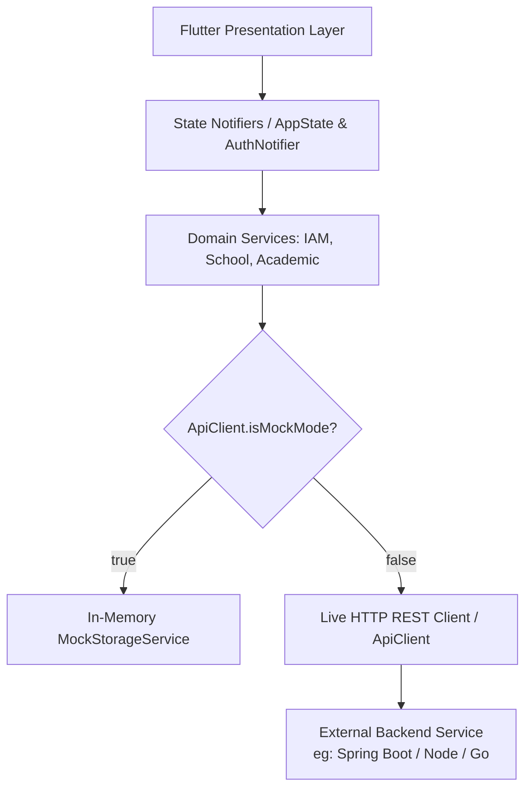

# How-To: Local Development & Environment Modes

This guide walks through setting up your local environment, running the **Ilmiya** Flutter application across platforms, and toggling between **Mock In-Memory Simulation** and **Live REST API** modes.

---

## Overview

Ilmiya is architected with a dual-mode service layer (`lib/core/services/api_client.dart`):



- **Mock Simulation Mode** (`isMockMode = true`): Fully functional in-memory storage seeded with mock schools, academic years, roles, and users (`MockStorageService`). No backend server or network connection required.
- **Live REST API Mode** (`isMockMode = false`): Real HTTP calls dispatched to `ILMIYA_API_BASE_URL` with automatic Bearer token injection, `X-Tenant-ID` header routing, and 401 token refresh loops.

---

## Step 1: Prerequisites & Verification

Ensure you have Flutter (>= 3.19.0) and Dart (>= 3.3.0) installed and verified:

```bash
# Check Flutter and Dart versions
flutter --version
dart --version

# Verify platform toolchain dependencies
flutter doctor
```

Install project dependencies:

```bash
flutter pub get
```

---

## Step 2: Run in Mock Simulation Mode (Zero-Backend)

By default, the application boots into **Mock Simulation Mode**. You can launch it on any supported device target immediately:

### Web (Google Chrome)
```bash
flutter run -d chrome
```

### Web (Headless / Custom Port)
Useful for remote dev machines or running inside Docker:
```bash
flutter run -d web-server --web-port=8080 --web-hostname=0.0.0.0
```

### Desktop Platforms
```bash
# macOS Desktop
flutter run -d macos

# Linux Desktop
flutter run -d linux
```

### Mobile Platforms
```bash
# iOS Simulator (macOS host only)
flutter run -d ios

# Android Emulator / Device
flutter run -d android
```

---

## Step 3: Configure Environment Flags via `--dart-define`

Flutter Web executes inside the browser sandbox and does not have native filesystem access to `.env` files at runtime. Environment variables are injected at compilation or launch time using `--dart-define`.

The client recognizes two primary build configuration keys:

| Flag Key | Description | Default Value |
|---|---|---|
| `ILMIYA_API_BASE_URL` | Base URL of the backend REST service (no trailing slash) | `http://localhost:8080` |
| `ILMIYA_DEFAULT_TENANT_ID` | Default tenant partition to target on initial boot | `tenant-lincoln-high-001` |

### Running Against a Local Backend (e.g. port 9090)
```bash
flutter run -d chrome \
  --dart-define=ILMIYA_API_BASE_URL=http://localhost:9090 \
  --dart-define=ILMIYA_DEFAULT_TENANT_ID=tenant-lincoln-high-001
```

### Running Against a Staging / Remote Backend
```bash
flutter run -d chrome \
  --dart-define=ILMIYA_API_BASE_URL=https://api-staging.ilmiya.edu \
  --dart-define=ILMIYA_DEFAULT_TENANT_ID=tenant-sma1-ilmiya-002
```

> [!TIP]
> In `lib/core/services/api_client.dart`, these values are resolved statically via:
> ```dart
> String _baseUrl = const String.fromEnvironment(
>   'ILMIYA_API_BASE_URL',
>   defaultValue: 'http://localhost:8080',
> );
> String tenantId = const String.fromEnvironment(
>   'ILMIYA_DEFAULT_TENANT_ID',
>   defaultValue: 'tenant-lincoln-high-001',
> );
> ```

---

## Step 4: Runtime Mode Toggling (In-App)

You do not need to restart the application to switch between Mock and Live API modes. The header bar includes an interactive **Mode Switcher Pill**:

1. Locate the pill in the top header navigation bar:
   - When in mock mode, it displays: `Mock Simulation` (with an amber/brown indicator).
   - When in live mode, it displays: `Live REST API` (with a green/sage indicator).
2. Click the mode pill to toggle:
   - Clicking immediately flips `apiClient.isMockMode`.
   - The UI displays an alert toast informing you of the active data provider.
   - All subsequent feature requests (School Profile, Academic Years, IAM Users) instantly route to the selected provider.

> [!NOTE]
> When switching to **Live REST API** mode, if no active authentication session exists, you will need to sign in with credentials matching your backend database (see [03. Authentication & Token Lifecycle](03-auth-tokens-and-tenant-switching.md)).

---

## Step 5: Hot Reload & Interactive Debugging

Flutter provides stateful Hot Reload during development:

- Press `r` in the terminal to trigger **Hot Reload** (updates UI widgets while preserving runtime state).
- Press `R` in the terminal to trigger **Hot Restart** (resets application state and re-executes `main()`).
- Press `v` to open the **Flutter DevTools** browser suite for CPU profiling, memory allocation checks, and widget tree inspection.

---

## Step 6: Code Quality & Static Analysis

Before submitting any code changes, run static analysis and unit test suites:

```bash
# Run static analysis (enforces strict linter rules)
flutter analyze

# Run all unit and widget tests
flutter test

# Run tests with detailed reporter output
flutter test --reporter expanded
```

---

## Troubleshooting

### Issue 1: `XMLHttpRequest error` on Web
- **Cause**: Browser blocked the request due to missing CORS headers on the backend service.
- **Resolution**: See [02. Backend API Integration & CORS Configuration](02-backend-api-integration-and-cors.md) to configure permitted origins and allowed headers (`X-Tenant-ID`, `Authorization`).

### Issue 2: Changes to `--dart-define` not reflecting
- **Cause**: Flutter web build cache held stale compilation artifacts.
- **Resolution**: Stop the process, run `flutter clean`, re-run `flutter pub get`, and launch again.
