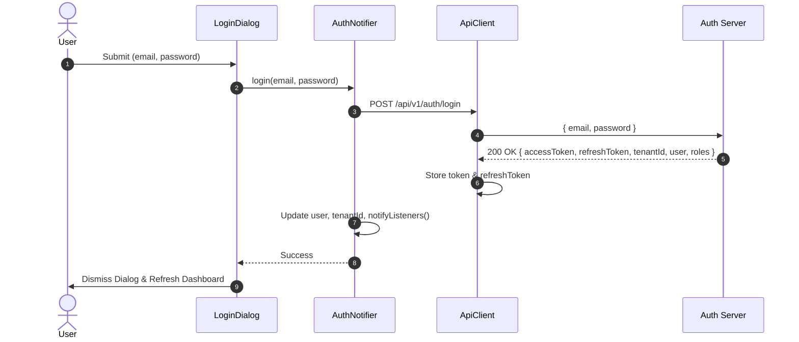

# How-To: Authentication, Token Lifecycle & Dynamic Tenant Switching

This guide walks through authenticating with custom backend credentials, managing JWT access and refresh token lifecycles, and dynamically switching tenant partitions without state contamination.

---

## Overview

In Ilmiya, authentication and multi-tenancy are coordinated across two central Singletons and Notifiers:

- **`ApiClient`** (`lib/core/services/api_client.dart`): Manages the raw `token`, `refreshToken`, and active `tenantId`. Automatically injects the bearer token, executes silent 401 token refreshes, and retries requests.
- **`AuthNotifier`** (`lib/state/auth_notifier.dart`): Holds reactive user state (`UserSummary`, `roles`, `permissions`, `tenantId`) and notifies listening widgets of session changes.



---

## Step 1: Authenticate with Custom Credentials

To authenticate against a live backend, launch the in-app **Login Dialog**:

1. Click on the **User Avatar** located in the top-right corner of the header.
2. Select **"Sign In with Custom Credentials"**.
3. Enter your account credentials:
   - **Email / Username** (e.g. `admin@lincoln.edu`)
   - **Password** (e.g. `••••••••••••`)
4. Click **Sign In**.

### Under the Hood: The Login Request
`AuthNotifier.login` sends a `POST` request to `/api/v1/auth/login`:

```http
POST /api/v1/auth/login HTTP/1.1
Host: api.ilmiya.edu
Content-Type: application/json
X-Tenant-ID: tenant-lincoln-high-001

{
  "email": "admin@lincoln.edu",
  "password": "Password123!"
}
```

### Expected Response (`200 OK`):
```json
{
  "accessToken": "eyJhbGciOiJSUzI1NiIsInR5cCI6IkpXVCJ9...",
  "refreshToken": "d7b29a1e-84fc-4e6a-bf02-998811223344",
  "tenantId": "tenant-lincoln-high-001",
  "roles": ["ADMINISTRATOR"],
  "permissions": ["school:read", "school:write", "iam:admin", "academic:manage"],
  "user": {
    "id": "usr-admin-001",
    "email": "admin@lincoln.edu",
    "fullName": "Administrator Lincoln",
    "avatarUrl": "https://images.unsplash.com/photo-1472099645785-5658abf4ff4e"
  }
}
```

Upon receiving this payload, `ApiClient` caches the tokens and `AuthNotifier` updates the application context.

---

## Step 2: Automatic Token Injection

Once authenticated, `ApiClient` attaches the Bearer token to all outgoing requests:

```dart
// lib/core/services/api_client.dart
final requestHeaders = <String, String>{
  'Content-Type': 'application/json',
  'Accept': 'application/json',
  if (tenantId.isNotEmpty) 'X-Tenant-ID': tenantId,
  if (token != null) 'Authorization': 'Bearer $token',
  ...?headers,
};
```

Developers writing domain services (e.g., `IamService`, `SchoolService`) never have to manually construct or append `Authorization` headers.

---

## Step 3: Silent 401 Refresh & Retry Loop

When an access token expires (typically after 5–15 minutes), downstream APIs return `401 Unauthorized`. 

`ApiClient` automatically intercepts the 401, pauses concurrent callers with an `_isRefreshing` guard, exchanges the `refreshToken`, and replays the original request:

```mermaid
flowchart TD
    Req[Outgoing Request] --> Resp{Response Code}
    Resp -- 200..299 --> Return[Return JSON Body]
    Resp -- 401 & refreshToken != null --> Guard{_isRefreshing?}
    Guard -- false --> Refresh[POST /api/v1/auth/refresh]
    Refresh -- 200 OK --> UpdateTokens[Update token & refreshToken]
    UpdateTokens --> Retry[Replay Original Request]
    Retry --> Return
    Refresh -- Refresh Failed --> Expire[triggerAuthExpired()]
    Expire --> Logout[Clear Session & Prompt Login]
    Resp -- Other Error --> Throw[Throw ApiException]
```

### Refresh Exchange Payload
```http
POST /api/v1/auth/refresh HTTP/1.1
Host: api.ilmiya.edu
Content-Type: application/json

{
  "refreshToken": "d7b29a1e-84fc-4e6a-bf02-998811223344"
}
```

### Handling Complete Session Expiry
If the refresh token itself is expired or revoked, `triggerAuthExpired()` is called:

```dart
// lib/core/services/api_client.dart
void triggerAuthExpired() {
  token = null;
  refreshToken = null;
  for (final listener in List.of(_onAuthExpiredListeners)) {
    listener();
  }
}
```

`AuthNotifier` registers a listener on `apiClient.onAuthExpired`:
- Local user credentials and permissions are purged.
- An alert is posted informing the user that the session has expired.
- The UI redirects the user back to the sign-in modal.

---

## Step 4: Dynamic Tenant Switching

Campus administrators overseeing multiple institutions can switch tenants without logging out.

1. Open the header navigation bar.
2. Click the **Tenant Selector** dropdown:
   - `Lincoln High School` (`tenant-lincoln-high-001`)
   - `SMA Negeri 1 Ilmiya` (`tenant-sma1-ilmiya-002`)
   - Or input a custom tenant ID.
3. Confirm switch.

### Behind the Scenes: `AuthNotifier.switchTenant`
```dart
// lib/state/auth_notifier.dart
Future<void> switchTenant(String newTenantId) async {
  if (isMockMode) {
    _tenantId = newTenantId;
    apiClient.tenantId = newTenantId;
    notifyListeners();
    return;
  }

  final response = await apiClient.request(
    endpoint: '/api/v1/auth/switch-tenant',
    method: 'POST',
    body: {'tenantId': newTenantId},
  );

  _tenantId = newTenantId;
  apiClient.tenantId = newTenantId;
  if (response != null && response is Map<String, dynamic>) {
    if (response['accessToken'] != null) {
      apiClient.token = response['accessToken'] as String;
    }
    // Update tenant-scoped roles and permissions
  }
  notifyListeners();
}
```

---

## Step 5: Enforcing Clean State Isolation via Keyed Re-mounting

A common bug in multi-tenant SPAs is displaying stale cached data when switching tenants. 

Ilmiya prevents cross-tenant contamination by using **ValueKey binding** at the root router level in `lib/main.dart`:

```dart
// lib/main.dart
IndexedStack(
  index: state.currentTab.clamp(0, 7),
  children: [
    SchoolProfileScreen(key: ValueKey('school_profile_${auth.tenantId}')),
    AcademicYearsScreen(key: ValueKey('academic_years_${auth.tenantId}')),
    IamManagementScreen(key: ValueKey('iam_management_${auth.tenantId}')),
    const PreviewScreen(),
    DashboardScreen(key: ValueKey('dashboard_${auth.tenantId}')),
    const GradesScreen(),
    const MessagingScreen(),
    const NotificationsScreen(),
  ],
)
```

### Why this matters:
- Flutter matches widget instances by their `Key`.
- When `auth.tenantId` changes, the old widget instance is completely destroyed (unmounted) and a new instance is constructed.
- All `initState()` hooks execute afresh, guaranteeing that data is loaded exclusively from the new tenant partition.

---

## Step 6: Session Revocation & Logout

To terminate an active session:

```dart
await context.read<AuthNotifier>().logout();
```

1. Sends `POST /api/v1/auth/logout` to the backend to invalidate server-side refresh tokens.
2. Clears in-memory tokens (`apiClient.token = null`, `apiClient.refreshToken = null`).
3. Reverts permissions back to the unauthenticated guest or default student profile.
4. Updates UI indicators.
