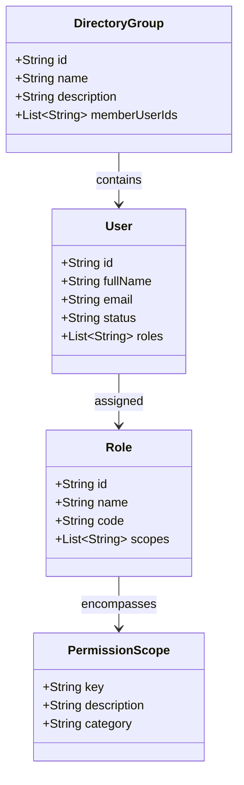

# How-To: IAM Administration & Role-Based Access Control (RBAC)

This guide walks through administering users, configuring Role-Based Access Control (RBAC) roles and fine-grained permission scopes, organizing directory groups, and verifying campus role perspectives in **Ilmiya**.

---

## Overview

Ilmiya provides an enterprise Identity and Access Management (IAM) module (`lib/features/iam_management/` and `lib/core/services/iam_service.dart`) structured around standard RBAC principles:



- **Users**: Campus participants identified by unique email and tenant-partitioned IDs.
- **Roles**: Logical collections of permission scopes (e.g. `ADMINISTRATOR`, `TEACHER`, `STUDENT`, `PARENT`).
- **Permission Scopes**: Fine-grained privileges matching resource patterns (e.g. `iam:admin`, `school:write`, `grades:edit`).
- **Directory Groups**: Cohort and departmental groupings for broadcast notifications and bulk management.

---

## Step 1: Access the IAM Administration Console

1. Navigate to the left navigation sidebar.
2. Select **"IAM & Users"** (or click the IAM tab at index 2).
3. Ensure the active tenant displayed in the header matches the school you wish to administer (e.g., `Lincoln High School`).

The console presents four primary operational sub-tabs:
- **Users**: Directory of provisioned student, teacher, parent, and admin accounts.
- **Roles**: RBAC definitions and attached permission scopes.
- **Groups**: Departmental and cohort groupings.
- **Audit Log**: Chronological trail of administrative actions.

---

## Step 2: Manage User Accounts

### 1. Provision a New User
1. In the **Users** tab, click **"Add New User"**.
2. Complete the user profile form:
   - **Full Name**: e.g., `Dr. Elena Vance`
   - **Email Address**: `e.vance@lincoln.edu`
   - **Initial Role**: Select from available roles (e.g. `TEACHER`)
   - **Phone Number** (Optional): `+1 (555) 019-2831`
3. Click **"Create User"**.

**API Call Dispatched:**
```http
POST /api/v1/iam/users HTTP/1.1
Host: api.ilmiya.edu
Content-Type: application/json
X-Tenant-ID: tenant-lincoln-high-001

{
  "fullName": "Dr. Elena Vance",
  "email": "e.vance@lincoln.edu",
  "role": "TEACHER",
  "phoneNumber": "+1 (555) 019-2831"
}
```

### 2. Toggle Account Status (`ACTIVE` / `SUSPENDED`)
To temporarily revoke campus access without deleting records:
1. Locate the user in the data table.
2. Click the **Status Badge** or the action menu (`⋮`).
3. Select **"Suspend Account"** or **"Activate Account"**.

**API Call Dispatched:**
```http
PATCH /api/v1/iam/users/usr-10293/status HTTP/1.1
Host: api.ilmiya.edu
Content-Type: application/json
X-Tenant-ID: tenant-lincoln-high-001

{
  "status": "SUSPENDED"
}
```

### 3. Assign or Revoke Roles
1. Open the user details drawer.
2. Click **"Manage Roles"**.
3. Toggle checkmarks for the desired roles (e.g. adding `DEPARTMENT_HEAD` to `TEACHER`).
4. Click **Save Changes**.

---

## Step 3: Configure Roles & Permission Scopes

Ilmiya supports custom, fine-grained RBAC roles beyond system defaults.

### 1. View Permission Scope Tree
Switch to the **Roles** tab and click **"Permission Scope Directory"** to inspect available granular scopes:

```text
├── school
│   ├── school:read          # View school profile, settings, and branding
│   └── school:write         # Update operational hours, settings, and details
├── academic
│   ├── academic:read        # View academic years, terms, and periods
│   └── academic:manage      # Create terms, activate academic years
├── iam
│   ├── iam:read             # View user directories, roles, and groups
│   └── iam:admin            # Provision users, assign roles, modify scopes
├── grades
│   ├── grades:view_all      # View grade records for all campus students
│   ├── grades:view_own      # View only own or dependent student grades
│   └── grades:edit          # Inline gradebook score editing and rubric entry
└── broadcasts
    └── broadcasts:dispatch  # Send campus-wide priority push notifications
```

### 2. Create a Custom Role
1. In the **Roles** tab, click **"Create New Role"**.
2. Specify:
   - **Role Code**: `ACADEMIC_COORDINATOR`
   - **Display Name**: `Academic Coordinator`
   - **Description**: `Manages term scheduling, gradebook auditing, and calendars`
3. Check the permitted scopes:
   - `school:read`
   - `academic:read`
   - `academic:manage`
   - `grades:view_all`
4. Click **"Save Role"**.

**API Call Dispatched:**
```http
POST /api/v1/iam/roles HTTP/1.1
Host: api.ilmiya.edu
Content-Type: application/json
X-Tenant-ID: tenant-lincoln-high-001

{
  "code": "ACADEMIC_COORDINATOR",
  "name": "Academic Coordinator",
  "description": "Manages term scheduling, gradebook auditing, and calendars",
  "scopes": ["school:read", "academic:read", "academic:manage", "grades:view_all"]
}
```

---

## Step 4: Organize Directory Groups

Directory Groups enable targeted campus broadcasts and cohort management.

1. Click the **Groups** sub-tab.
2. Click **"New Group"**.
3. Define the group metadata:
   - **Group Name**: `Science Faculty & Lab Assistants`
   - **Group Type**: `FACULTY_DEPARTMENT`
   - **Description**: `All biology, physics, and chemistry educators`
4. Search and select members to add to the group.
5. Click **"Create Group"**.

### Adding / Removing Members:
To add members to an existing group:
```http
POST /api/v1/iam/groups/grp-sci-01/members HTTP/1.1
Host: api.ilmiya.edu
Content-Type: application/json
X-Tenant-ID: tenant-lincoln-high-001

{
  "userId": "usr-10293"
}
```

---

## Step 5: Test Multi-Role Campus Perspectives

During development and testing, you can preview the UI through the lens of any of the 4 campus personas without creating new browser sessions:

1. Click the **Role Switcher Dropdown** in the header bar.
2. Select the perspective you want to preview:
   - **Student** (`Alex Chen`): Inspects student dashboard, grade tracking, What-If simulator, and assignment inquiries.
   - **Teacher** (`Sarah Jenkins`): Inspects roster view, gradebook scoring, office hours scheduler, and announcements.
   - **Parent** (`Michael Jenkins`): Inspects child progress reports, attendance summaries, and direct teacher messaging.
   - **Administrator** (`Principal Martinez`): Unlocks IAM management, school profile configuration, and academic year administration.

### Programmatic Switching
In widget tests or integration flows:
```dart
context.read<AppState>().setCurrentUser(MockData.teacherProfile);
```
The UI reactively re-evaluates role-gated buttons, tabs, and action drawers.
