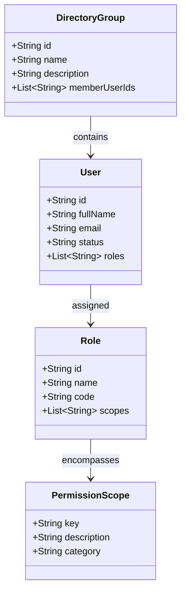

# How-To: IAM Administration & Role-Based Access Control (RBAC)

This guide walks through administering users, configuring Role-Based Access Control (RBAC) roles and fine-grained permission scopes, organizing directory groups, and verifying campus role perspectives in **Ilmiya**.

---

## Overview

Ilmiya provides an enterprise Identity and Access Management (IAM) module (`lib/features/iam_management/` and `lib/core/services/iam_service.dart`) structured around standard RBAC principles:



- **Users**: Campus participants identified by unique email and tenant-partitioned IDs.
- **Roles**: Logical collections of permission scopes (e.g. `ADMINISTRATOR`, `TEACHER`, `STUDENT`, `PARENT`).
- **Permission Scopes**: Fine-grained privileges matching resource patterns (e.g. `iam:admin`, `school:write`, `grades:edit`).
- **Directory Groups**: Cohort and departmental groupings for broadcast notifications and bulk management.

---

## Step 1: Access the IAM Administration Console

1. Navigate to the left navigation sidebar.
2. Select **"IAM & Users"** (or click the IAM tab at index 2).
3. Ensure the active tenant displayed in the header matches the school you wish to administer (e.g., `Lincoln High School`).

The console presents four primary operational sub-tabs:
- **Users**: Directory of provisioned student, teacher, parent, and admin accounts.
- **Roles**: RBAC definitions and attached permission scopes.
- **Groups**: Departmental and cohort groupings.
- **Audit Log**: Chronological trail of administrative actions.

---

## Step 2: Manage User Accounts

### 1. Provision a New User
1. In the **Users** tab, click **"Add New User"**.
2. Complete the user profile form:
   - **Full Name**: e.g., `Dr. Elena Vance`
   - **Email Address**: `e.vance@lincoln.edu`
   - **Initial Role**: Select from available roles (e.g. `TEACHER`)
   - **Phone Number** (Optional): `+1 (555) 019-2831`
3. Click **"Create User"**.

**API Call Dispatched:**
```http
POST /api/v1/iam/users HTTP/1.1
Host: api.ilmiya.edu
Content-Type: application/json
X-Tenant-ID: tenant-lincoln-high-001

{
  "fullName": "Dr. Elena Vance",
  "email": "e.vance@lincoln.edu",
  "role": "TEACHER",
  "phoneNumber": "+1 (555) 019-2831"
}
```

### 2. Toggle Account Status (`ACTIVE` / `SUSPENDED`)
To temporarily revoke campus access without deleting records:
1. Locate the user in the data table.
2. Click the **Status Badge** or the action menu (`⋮`).
3. Select **"Suspend Account"** or **"Activate Account"**.

**API Call Dispatched:**
```http
PATCH /api/v1/iam/users/usr-10293/status HTTP/1.1
Host: api.ilmiya.edu
Content-Type: application/json
X-Tenant-ID: tenant-lincoln-high-001

{
  "status": "SUSPENDED"
}
```

### 3. Assign Role and Boundary Scope
1. In the **Users** tab, find the target user and click **"Assign Role"**.
2. In the **Assign Role & Scope Dialog**:
   - **Target Role**: Select from the tenant's available system or custom roles (e.g. `TEACHER`, `SCHOOL_ADMIN`).
   - **Boundary Scope**: Select the user's data boundary from the hierarchical scope selector (e.g. root scope `/ROOT`, or child scopes like `/ROOT/CAMPUS_MAIN` or `/ROOT/CAMPUS_MAIN/HIGH_SCHOOL`).
3. Click **"Assign Role & Scope"**.
4. The user tile updates dynamically with badges indicating both the active assigned role and contextual scope path.

**API Call Dispatched:**
```http
POST /api/v1/users/{userId}/roles HTTP/1.1
Host: api.ilmiya.edu
Content-Type: application/json
X-Tenant-ID: tenant-lincoln-high-001

{
  "roleId": "role-teacher",
  "tenantId": "tenant-lincoln-high-001",
  "scopeNodeId": "scope-science"
}
```

---

## Step 3: Configure Roles & Permission Scopes

Ilmiya supports custom, fine-grained RBAC roles beyond system defaults.

### 1. View Permission Scope Tree
Switch to the **Roles** tab and click **"Permission Scope Directory"** to inspect available granular scopes:

```text
├── school
│   ├── school:read          # View school profile, settings, and branding
│   └── school:write         # Update operational hours, settings, and details
├── academic
│   ├── academic:read        # View academic years, terms, and periods
│   └── academic:manage      # Create terms, activate academic years
├── iam
│   ├── iam:read             # View user directories, roles, and groups
│   └── iam:admin            # Provision users, assign roles, modify scopes
├── grades
│   ├── grades:view_all      # View grade records for all campus students
│   ├── grades:view_own      # View only own or dependent student grades
│   └── grades:edit          # Inline gradebook score editing and rubric entry
└── broadcasts
    └── broadcasts:dispatch  # Send campus-wide priority push notifications
```

### 2. Create a Custom Role
1. In the **Roles** tab, click **"Create Custom Role"**.
2. Specify:
   - **Role Code**: `ACADEMIC_COORDINATOR`
   - **Display Name**: `Academic Coordinator`
   - **Description**: `Manages term scheduling, gradebook auditing, and calendars`
3. Toggle the permitted permission chips:
   - `school:profile:read`
   - `academic:year:read`
   - `academic:year:create`
   - `exam:grade:read`
4. Click **"Save Role"**.

**API Call Dispatched:**
```http
POST /api/v1/roles HTTP/1.1
Host: api.ilmiya.edu
Content-Type: application/json
X-Tenant-ID: tenant-lincoln-high-001

{
  "code": "ACADEMIC_COORDINATOR",
  "name": "Academic Coordinator",
  "description": "Manages term scheduling, gradebook auditing, and calendars",
  "permissions": ["school:profile:read", "academic:year:read", "academic:year:create", "exam:grade:read"]
}
```

### 3. Edit & Delete Custom Roles
Each role card in the **Roles & RBAC** matrix provides lifecycle actions:
- **Edit Role**: Click the pencil icon to open `EditRoleDialog`. Modify display name, description, or toggle fine-grained permission chips. Dispatches `PUT /api/v1/roles/{roleId}`.
- **Delete Role**: Click the trash icon on any custom role. A confirmation dialog appears to prevent accidental removal. Dispatches `DELETE /api/v1/roles/{roleId}`.
- **System Role Protection**: System roles (e.g. `SUPERADMIN`, `TENANT_ADMIN`, `SCHOOL_ADMIN`, `TEACHER`, `STUDENT`) display an immutable `SYSTEM` badge and cannot be deleted, preserving core institutional security invariants.

---

## Step 4: Organize Directory Groups

Directory Groups enable targeted campus broadcasts and cohort management.

1. Click the **Groups** sub-tab.
2. Click **"New Group"**.
3. Define the group metadata:
   - **Group Name**: `Science Faculty & Lab Assistants`
   - **Group Type**: `FACULTY_DEPARTMENT`
   - **Description**: `All biology, physics, and chemistry educators`
4. Search and select members to add to the group.
5. Click **"Create Group"**.

### Adding / Removing Members:
To add members to an existing group:
```http
POST /api/v1/iam/groups/grp-sci-01/members HTTP/1.1
Host: api.ilmiya.edu
Content-Type: application/json
X-Tenant-ID: tenant-lincoln-high-001

{
  "userId": "usr-10293"
}
```

---

## Step 5: Test Multi-Role Campus Perspectives

During development and testing, you can preview the UI through the lens of any of the 6 demo personas without creating new browser sessions:

1. Click the **User / Persona Menu** in the header or sidebar footer.
2. Select the perspective you want to preview:
   - **Platform SuperAdmin** (`Dr. Sarah Jenkins` - `admin.utama@ilmiya.edu`): Global platform operations. Starts in platform mode (only Tenant Console visible); switch session to any tenant row to access full capabilities.
   - **Foundation Tenant Admin** (`Ustadz Ahmad Fauzi` - `admin.yayasan@darussalam.org`): Foundation organizational governance and tenant-wide IAM administration under `/ROOT` scope.
   - **School Principal** (`Prof. Marcus Chen` - `principal@ilmiya.edu`): School operational settings, academic years, calendars, and institutional administration.
   - **Senior Faculty** (`Dr. Eleanor Vance` - `eleanor.vance@ilmiya.edu`): Course grading, gradebook evaluations, and student records.
   - **Student (Class 10-A)** (`Alex Rivera` - `alex.rivera@student.ilmiya.edu`): Student portal, schedules, and grade tracking.
   - **Parent / Guardian** (`Elena Rivera` - `elena.rivera@parent.ilmiya.edu`): Ward attendance oversight and semester report cards.

### Programmatic Switching
In widget tests or integration flows:
```dart
await context.read<AuthNotifier>().loginAsPersona(DemoPersonaKey.tenantAdmin);
```
The UI reactively re-evaluates role-gated buttons, tabs, and action drawers.
