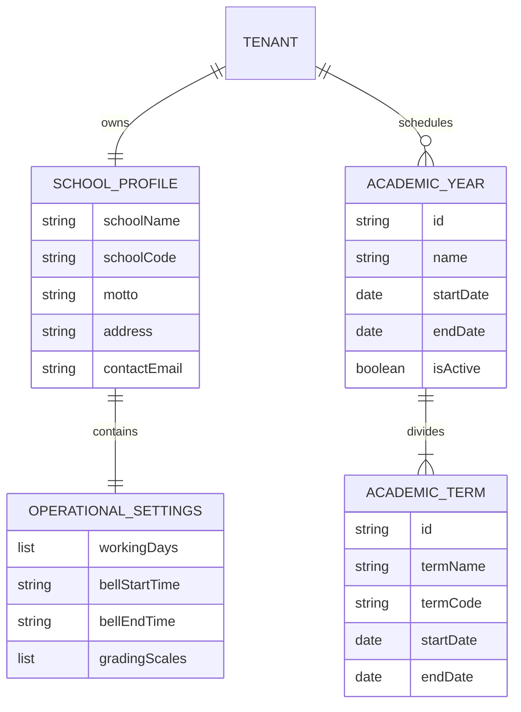

# How-To: School Profile & Academic Calendar Setup

This guide walks through configuring institutional branding, operational settings (working hours, grading scales), provisioning academic years, and managing terms in **Ilmiya**.

---

## Overview

Every school partition in Ilmiya maintains its own isolated institutional profile and calendar structure:



These entities are managed through two dedicated screens:
- **`SchoolProfileScreen`** (`lib/features/school_profile/presentation/school_profile_screen.dart`)
- **`AcademicYearsScreen`** (`lib/features/academic_years/presentation/academic_years_screen.dart`)

---

## Step 1: Configure School Branding & Profile

1. Select **"School Profile"** from the left navigation bar (Tab index 0).
2. Review the existing institutional details:
   - **School Name**: e.g., `Lincoln High School`
   - **Institutional Code**: `LHS-001`
   - **Motto / Tagline**: e.g., *Excellence in Academics & Character*
   - **Physical Address**: `1244 University Avenue, Cambridge, MA 02138`
   - **Primary Contact**: `office@lincoln.edu` | `+1 (617) 555-0199`
3. Click **"Edit Profile"** to modify values.
4. Click **"Save Changes"** to commit updates.

### API Payload (`PUT /api/v1/schools/profile`):
```json
{
  "schoolName": "Lincoln High School",
  "schoolCode": "LHS-001",
  "motto": "Excellence in Academics & Character",
  "address": "1244 University Avenue, Cambridge, MA 02138",
  "contactEmail": "office@lincoln.edu",
  "contactPhone": "+1 (617) 555-0199",
  "websiteUrl": "https://lincoln.edu"
}
```

---

## Step 2: Configure Operational Settings & Grading Scales

Switch to the **Operational Settings** tab within the School Profile screen.

### 1. Working Days & School Hours
- **Active Working Days**: Check the standard instructional days (e.g. `Monday`, `Tuesday`, `Wednesday`, `Thursday`, `Friday`).
- **Bell Schedule**:
  - **Instruction Start**: `08:00 AM`
  - **Instruction End**: `03:30 PM`
  - **Standard Period Duration**: `50 minutes`
  - **Passing Interval**: `10 minutes`

### 2. Institutional Grading Scale Standards
Define the cutoffs used by gradebook tracking and the "What-If" simulator:

| Grade | Min Percentage | GPA Point (4.0) | Honors / AP (5.0) |
|---|---|---|---|
| **A** | 93.0% | 4.0 | 5.0 |
| **A-** | 90.0% | 3.7 | 4.7 |
| **B+** | 87.0% | 3.3 | 4.3 |
| **B** | 83.0% | 3.0 | 4.0 |
| **B-** | 80.0% | 2.7 | 3.7 |
| **C+** | 77.0% | 2.3 | 3.3 |
| **C** | 73.0% | 2.0 | 3.0 |
| **F** | 0.0% | 0.0 | 0.0 |

Click **"Save Settings"** to dispatch `PUT /api/v1/schools/settings`.

---

## Step 3: Provision an Academic Year

1. Select **"Academic Years"** from the left navigation bar (Tab index 1).
2. Click **"Add Academic Year"** in the top-right corner.
3. Complete the modal form:
   - **Academic Year Name**: `2026-2027 Academic Year`
   - **Year Code**: `AY-2026-2027`
   - **Start Date**: `2026-08-15`
   - **End Date**: `2027-06-15`
4. Click **"Create Academic Year"**.

### API Request:
```http
POST /api/v1/academic-years HTTP/1.1
Host: api.ilmiya.edu
Content-Type: application/json
X-Tenant-ID: tenant-lincoln-high-001

{
  "name": "2026-2027 Academic Year",
  "code": "AY-2026-2027",
  "startDate": "2026-08-15T00:00:00Z",
  "endDate": "2027-06-15T23:59:59Z"
}
```

---

## Step 4: Divide Academic Year into Terms

Once an academic year is provisioned, you must divide it into instructional terms:

1. Click on the newly created academic year card to expand details.
2. Under the **Terms** section, click **"Add Term"**.
3. Configure each instructional period:

### Fall Term
- **Term Name**: `Fall Semester 2026`
- **Term Code**: `AY26-T1`
- **Start Date**: `2026-08-15`
- **End Date**: `2026-12-20`

### Spring Term
- **Term Name**: `Spring Semester 2027`
- **Term Code**: `AY26-T2`
- **Start Date**: `2027-01-10`
- **End Date**: `2027-06-15`

### API Request:
```http
POST /api/v1/academic-years/ay-2026-2027/terms HTTP/1.1
Host: api.ilmiya.edu
Content-Type: application/json
X-Tenant-ID: tenant-lincoln-high-001

{
  "termName": "Fall Semester 2026",
  "termCode": "AY26-T1",
  "startDate": "2026-08-15T00:00:00Z",
  "endDate": "2026-12-20T23:59:59Z"
}
```

---

## Step 5: Activate the Academic Year

Only one academic year can be active per tenant at any given time. Setting an academic year as active anchors course enrollments, current grades, and class schedules across the entire student and teacher experience.

1. Locate the desired academic year in the list.
2. Click the **"Set as Active"** button (or check the Active badge).
3. Confirm the activation dialog.

### API Request:
```http
POST /api/v1/academic-years/ay-2026-2027/activate HTTP/1.1
Host: api.ilmiya.edu
Content-Type: application/json
X-Tenant-ID: tenant-lincoln-high-001
```

### Verification
- The status badge on the card updates immediately to **"ACTIVE"**.
- Other academic years are automatically marked as **"COMPLETED"** or **"UPCOMING"**.
- Navigating to the **Dashboard** or **Grades** tab reflects courses and timetable periods belonging to the active year.
