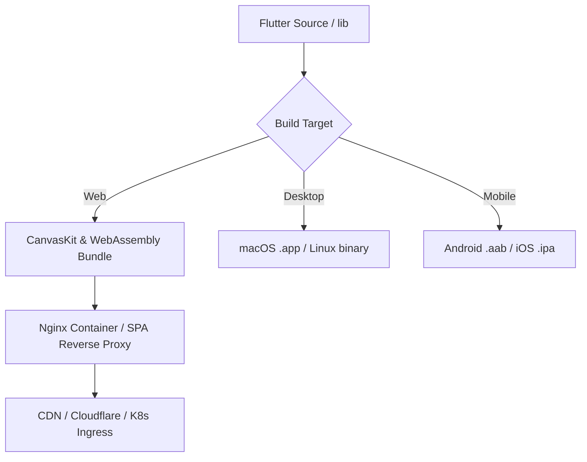

# How-To: Production Build & Multiplatform Deployment

This guide walks through compiling optimized production artifacts for **Ilmiya Frontend**, deploying the Web application using Nginx and Docker with SPA fallback routing, and packaging native desktop and mobile releases.

---

## Overview

Ilmiya is a multiplatform Flutter codebase supporting Web, Desktop (macOS, Linux), and Mobile (Android, iOS).



Production builds require injecting concrete environment definitions at compile-time to bake in your backend endpoint and tenant configuration.

---

## Step 1: Compile Web Production Release

Flutter Web compiles Dart code into JavaScript and WebAssembly (`canvaskit.wasm`). 

Run the production build specifying CanvasKit rendering and production flags:

```bash
flutter build web --release \
  --web-renderer canvaskit \
  --base-href "/" \
  --dart-define=ILMIYA_API_BASE_URL=https://api.ilmiya.edu \
  --dart-define=ILMIYA_DEFAULT_TENANT_ID=tenant-lincoln-high-001
```

### Build Artifact Output
The optimized distribution is generated in `build/web/`:
```text
build/web/
├── index.html
├── main.dart.js
├── flutter_service_worker.js
├── canvaskit/
│   ├── canvaskit.wasm
│   └── canvaskit.js
├── assets/
└── manifest.json
```

> [!IMPORTANT]
> Always compile with `--web-renderer canvaskit` for SIS deployments. CanvasKit ensures pixel-perfect typography rendering, correct squircle clipping, and fluid data grid scrolling matching native desktop apps.

---

## Step 2: Nginx Web Server Configuration

Single-Page Applications require the web server to route deep links back to `index.html`. Furthermore, modern browsers require correct MIME types for WebAssembly files (`.wasm`).

Create `/etc/nginx/conf.d/ilmiya.conf`:

```nginx
server {
    listen 80;
    listen [::]:80;
    server_name app.ilmiya.edu;

    root /usr/share/nginx/html;
    index index.html;

    # Gzip compression for Flutter Web assets
    gzip on;
    gzip_types text/plain text/css application/json application/javascript text/xml application/xml application/xml+rss text/javascript application/wasm;
    gzip_min_length 1000;

    # Correct MIME type for WebAssembly
    types {
        application/wasm wasm;
    }

    # Cache static assets aggressively (hashed files)
    location ~* \.(?:ico|css|js|gif|jpe?g|png|wasm|woff2?|eot|ttf|svg)$ {
        expires 1y;
        add_header Cache-Control "public, max-age=31536000, immutable";
        access_log off;
    }

    # Disable cache for index.html and service worker to ensure instant updates
    location = /index.html {
        expires -1;
        add_header Cache-Control "no-store, no-cache, must-revalidate";
    }

    location = /flutter_service_worker.js {
        expires -1;
        add_header Cache-Control "no-store, no-cache, must-revalidate";
    }

    # SPA Fallback Routing: redirect all 404s to index.html
    location / {
        try_files $uri $uri/ /index.html;
    }

    # Security Headers
    add_header X-Frame-Options "SAMEORIGIN" always;
    add_header X-Content-Type-Options "nosniff" always;
    add_header Referrer-Policy "strict-origin-when-cross-origin" always;
}
```

---

## Step 3: Dockerized Deployment

Package the application as a lightweight container using a multi-stage Dockerfile:

### `Dockerfile`
```dockerfile
# -------------------------------------------------------------
# Stage 1: Build Flutter Web Release
# -------------------------------------------------------------
FROM ghcr.io/cirruslabs/flutter:3.19.6 AS builder

WORKDIR /app

# Copy dependency specifications first for layer caching
COPY pubspec.yaml pubspec.lock ./
RUN flutter pub get

# Copy full source tree
COPY . .

# Compile release web bundle
ARG API_BASE_URL=https://api.ilmiya.edu
ARG DEFAULT_TENANT=tenant-lincoln-high-001

RUN flutter build web --release \
  --web-renderer canvaskit \
  --dart-define=ILMIYA_API_BASE_URL=${API_BASE_URL} \
  --dart-define=ILMIYA_DEFAULT_TENANT_ID=${DEFAULT_TENANT}

# -------------------------------------------------------------
# Stage 2: Serve via Lightweight Nginx
# -------------------------------------------------------------
FROM nginx:alpine

COPY nginx.conf /etc/nginx/conf.d/default.conf
COPY --from=builder /app/build/web /usr/share/nginx/html

EXPOSE 80

CMD ["nginx", "-g", "daemon off;"]
```

### Build & Run Container
```bash
# Build the image
docker build -t ilmiya-frontend:latest \
  --build-arg API_BASE_URL=https://api.ilmiya.edu \
  --build-arg DEFAULT_TENANT=tenant-lincoln-high-001 .

# Run the container
docker run -d -p 8080:80 --name ilmiya-app ilmiya-frontend:latest
```

---

## Step 4: Build Desktop Releases

Desktop builds provide offline-first, native windowing performance for administrative workstations.

### macOS Release Bundle
```bash
# Build .app bundle
flutter build macos --release \
  --dart-define=ILMIYA_API_BASE_URL=https://api.ilmiya.edu \
  --dart-define=ILMIYA_DEFAULT_TENANT_ID=tenant-lincoln-high-001
```
Output path: `build/macos/Build/Products/Release/ilmiya.app`

### Linux Desktop Executable
```bash
flutter build linux --release \
  --dart-define=ILMIYA_API_BASE_URL=https://api.ilmiya.edu \
  --dart-define=ILMIYA_DEFAULT_TENANT_ID=tenant-lincoln-high-001
```
Output path: `build/linux/x64/release/bundle/`

---

## Step 5: Build Mobile Packages

### Android Release Bundle (.aab / .apk)
```bash
# Google Play Store App Bundle (.aab)
flutter build appbundle --release \
  --dart-define=ILMIYA_API_BASE_URL=https://api.ilmiya.edu \
  --dart-define=ILMIYA_DEFAULT_TENANT_ID=tenant-lincoln-high-001

# Standalone APK (.apk)
flutter build apk --release \
  --dart-define=ILMIYA_API_BASE_URL=https://api.ilmiya.edu \
  --dart-define=ILMIYA_DEFAULT_TENANT_ID=tenant-lincoln-high-001
```

### iOS Release Archive (.ipa)
Requires macOS host with Xcode command line tools:
```bash
flutter build ipa --release \
  --dart-define=ILMIYA_API_BASE_URL=https://api.ilmiya.edu \
  --dart-define=ILMIYA_DEFAULT_TENANT_ID=tenant-lincoln-high-001
```

---

## Step 6: Production Readiness Checklist

Before publishing to production, verify the following:

- [ ] **HTTPS Enforced**: Ensure all traffic redirects to SSL/TLS.
- [ ] **WASM MIME Type**: Check that your CDN / server serves `canvaskit.wasm` with `Content-Type: application/wasm`:
  ```bash
  curl -I https://app.ilmiya.edu/canvaskit/canvaskit.wasm | grep -i content-type
  ```
- [ ] **SPA History Fallback**: Verify that navigating directly to deep URLs (e.g. `https://app.ilmiya.edu/grades`) does not return an HTTP 404 from Nginx.
- [ ] **CORS Ingress**: Verify the backend allows the production frontend origin domain.
- [ ] **Live REST Mode Active**: Confirm the default production build points to the live backend and does not stay in mock in-memory storage.
